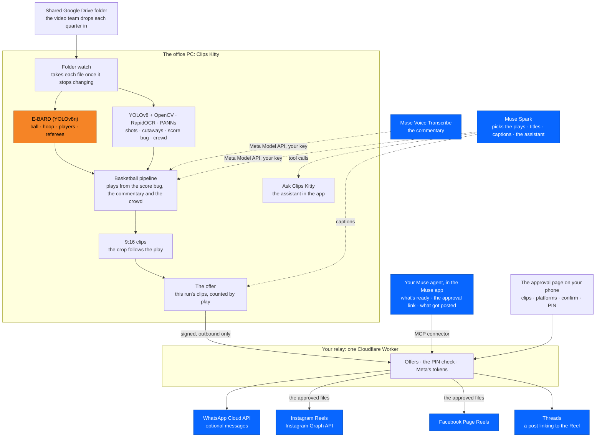

<div align="center">

# Clips Kitty - Basketball Highlights for Meta

**Turn a basketball game into vertical highlight clips on your own PC, approve them from your Muse agent, and post them through Instagram's, Facebook's and Threads' own APIs. Muse Spark and Muse Voice do the writing and the listening. E-BARD, YOLO and OpenCV read the game.**

Meta Global AI Developer Hackathon 2026 · Track: **Indie** · Licence: **AGPL-3.0**

[What's new](docs/hackathon/meta/NEW_WORK.md) · [Architecture](docs/hackathon/meta/ARCHITECTURE.md) · [Judge setup](docs/hackathon/meta/JUDGE_SETUP.md) · [Demo script](docs/hackathon/meta/DEMO_SCRIPT.md) · [Muse connector](docs/hackathon/meta/MUSE_CONNECTOR.md) · [Security](docs/hackathon/meta/SECURITY.md) · [Test log](docs/hackathon/meta/TEST_LOG.md)


</div>

This repository is the Meta hackathon edition of **[Clips Kitty](https://github.com/ColinGPT9/clips-studio)**,
a free, open-source AI video clipper. It covers only what the hackathon adds:
Meta's models, Meta's apps and Meta's publishing APIs around the
**Sports → Basketball** pipeline. Everything else about the app is documented in
the original repository.

## Who it's for

Say you're the social media manager for an NBA team, running its Instagram,
Facebook and Threads. Sports highlights are huge on Instagram, and while a game
is on, it's trending, so the clips need to go up during the game or right after,
while people are still talking about it. And you're at the game, not at your desk.

The video team drops each quarter into a shared Google Drive folder. Clips Kitty,
on the office PC, clips it by itself. Your Muse agent tells you what's ready, and
you approve from your phone.

## What it does

1. **Picks up the game by itself.** A watch on the shared Drive folder takes each
   video file once it has stopped changing.
2. **Reads the game on the PC:** E-BARD finds the ball, hoop, players and
   referees; YOLO and OpenCV the shots and cutaways; RapidOCR the score bug and
   clock; PANNs the crowd and buzzer. **Muse Voice Transcribe** transcribes the
   commentary, with Whisper on the PC if Meta can't.
3. **Asks Muse Spark which plays are worth posting and writes the titles with
   it**, then checks each title against the scoreboard. A title that names the
   wrong play or scorer is written again.
4. **Cuts each play to 9:16**, the crop following the play.
5. **Offers the clips to your phone.** Your **Muse agent** can list what's ready
   and send you the approval link, and WhatsApp can message you. Nothing is posted
   until you pick the clips and platforms, tick confirm and enter your PIN on the
   approval page.
6. **Posts through Meta's own APIs:**
   - an Instagram Reel (Instagram Graph API);
   - a Facebook Page Reel;
   - a Threads post linking to the Reel.

   **Muse Spark** writes each platform's caption. Only what the APIs confirm is
   reported as posted, with the links.
7. **Ask Clips Kitty**, the assistant inside the app, runs on **Muse Spark** with
   the app's own tools.

Muse Spark and Muse Voice are called on the creator's own Meta Model API key,
chosen in **Settings → AI**. Without one, the same steps run on the PC: Whisper
transcribes, and a local Gemma model picks and writes.

## What's new for the hackathon

- **Remote approval** (`remote_approval/`, `meta-relay/`). The PC never opens a
  port. It sends signed requests out to a small relay the creator owns, one
  Cloudflare Worker with a D1 database, which holds Meta's tokens. Approving
  takes the approval page, the confirm box and a PIN that locks after wrong
  tries.
- **Publishing through Meta's APIs** (`publish/meta_graph.py`):
  - Instagram Reels by resumable upload;
  - Facebook Page Reels;
  - Threads posts.

  The PC checks every file against the approved offer before uploading it, and
  never posts a clip twice to the same place.
- **The Muse connector** (`meta-relay/lib/muse.js`). Your Muse agent connects to
  your relay over MCP, with the same tools as plain HTTPS routes and an OpenAPI
  description. It can list what's ready, send the approval link, say what got
  posted, set a reminder or cancel an offer. It has no tool that approves or
  posts. Each PC makes its own `ckm_` key in Settings, and the relay stores only
  its hash.
- **Muse Voice Transcribe** as a transcription provider. It times each spoken
  turn, not each word, so no word timings are made up. Whisper on the PC takes
  over if Meta can't transcribe.
- **Muse Spark captions**: one structured request per offer writes every clip's
  Instagram caption, Facebook description and Threads post. The model is told
  only what the pipeline found, and its answer is checked.
- **Ask Clips Kitty on Muse Spark**: with a Meta key saved, the assistant at the
  bottom of the app runs on Muse Spark and says so in its corner.
- **WhatsApp Cloud API** messages for the creator who wants them: highlights
  ready, the results, and Remind me later or Cancel buttons.
- **Watched folders and "Ask me on my phone"** on the Watch page. A new file in a
  shared folder is clipped and offered to the phone, never posted on its own.
- **Gaming and other videos**, offered too once the creator opts in.

Nothing was trained, fine-tuned or replaced. Every changed file is listed in
[NEW_WORK.md](docs/hackathon/meta/NEW_WORK.md).

## Architecture



| Component | Role | New for the hackathon? |
|---|---|---|
| **Muse Spark** (Meta Model API) | Picks the plays and writes the titles when chosen in Settings → AI; writes each platform's caption; runs Ask Clips Kitty | Captions and the assistant are new. Picking plays and titles uses the app's existing Meta provider |
| **Muse Voice Transcribe** (Meta Model API) | Transcribes the commentary, timed by turn | **New** |
| **Your Muse agent** (the Muse app) | Asks the relay what's ready, gets the approval link, reads what got posted, sets a reminder or cancels. Never approves | **New** (the connector) |
| **Instagram Graph API**, **Facebook Pages API**, **Threads API** | Reels on Instagram and the Facebook Page, a Threads post linking to the Reel | **New** |
| **WhatsApp Cloud API** | Optional messages to the creator, from approved templates | **New** |
| **The relay** (Cloudflare Workers, D1) | Holds Meta's tokens, the offers and the PIN check; hosts the approval page and the Muse connector | **New** |
| **[E-BARD](https://github.com/GabrieleGiudic/E-BARD)** | A YOLOv8n detector for basketball broadcasts: the ball, hoop, players and referees, for the 9:16 framing. Used unmodified under CC BY 4.0 | No |
| **YOLOv8** (Ultralytics, COCO), **OpenCV**, **RapidOCR**, **PANNs** | Shots and cutaways, the score bug and game clock, the crowd, whistle and buzzer | No |
| **Whisper** (faster-whisper), **FFmpeg** | Transcription on the PC when Muse Voice isn't chosen or can't; cutting, captions and encoding | No |

**What Meta sees.**
- **Muse Voice:** the commentary audio, sent in parts, skipping any part where
  nobody speaks.
- **Muse Spark:** the transcript and the events beside it, the windows the
  basketball moments proposed, and each clip's scoreboard note. For captions, it
  also gets each clip's play, title and the names the scoreboard gave.
- **No model sees the picture.** The checks that look at frames run on the PC
  only.
- **Clip files** leave the PC only after an approval, for the platforms chosen.

**Why it stays modular.**
- The Basketball code never names a provider. Muse Spark and Muse Voice are
  entries in the provider catalogue (`llm/providers/catalog.py`).
- Everything that talks to Meta's apps and publishing APIs lives in the relay
  (`meta-relay/`) and `remote_approval/`. The vision pipeline is the original,
  unchanged.

## Tested, and what isn't live yet

Every test fakes Meta's servers: no WhatsApp message has been sent and nothing
has been posted. The relay's tests run the real Worker code with Meta faked, and
the end-to-end tests drive the real engine against it, playing the phone and the
Muse agent.

| Suite | Result (30 October 2026) |
|---|---|
| Relay, `cd meta-relay && npm test` | **58 passed** |
| The Meta tests in a clean venv (`pyyaml requests pytest fastapi httpx`) | **180 passed**, 13 skipped (they need numpy) |
| With the app's full dependencies: the Meta, assistant, folder, API contract and MCP files | **379 passed**, 2 skipped (checks of the original app's README) |
| The mock run, `python scripts/meta_demo.py` | Offer → approval with the PIN → 9 of 9 fake posts confirmed |

**Not tried against live services yet:**
- the Muse app's custom connectors: which MCP version they speak, and whether
  they take a key in a header;
- the Meta Model API, for Muse Spark and Muse Voice;
- WhatsApp;
- publishing through the Graph API.

Details are in the [test log](docs/hackathon/meta/TEST_LOG.md).

## Quick start

**The mock run, two minutes, no accounts.** It runs the real relay and engine code with Meta's servers faked:

```bash
git clone https://github.com/ColinGPT9/Clips-Kitty-Meta-Basketball
cd Clips-Kitty-Meta-Basketball
pip install pyyaml requests
python scripts/meta_demo.py        # needs Node 22.5+ and ffmpeg
```

**The app.** You need Python 3.11, Node 22.5+ and FFmpeg.

```bash
pip install -r requirements.txt
python scripts/fetch_basketball_model.py && python scripts/fetch_panns.py
cd ui && npm install && npm run dev   # the desktop app
```

In a second terminal, from the repository, `cd meta-relay && npm run dev` starts
the relay with Meta faked and prints its enrolment key.

In the app:

1. **Settings → AI → Direct provider API → Meta (Muse Spark):** paste a Meta Model API key.
   - Choose Meta (Muse Spark) under **Clip picking, titles and the assistant**.
   - Choose `muse-voice-transcribe-1.0` under **Transcription**.
2. **Settings → Notifications & Remote Approval:**
   - connect the relay;
   - make a key for your Muse agent;
   - set a PIN and connect the accounts;
   - tick **Let me approve publishing from my phone** and **Write captions with Muse Spark**.
3. **Watched channels:** switch **Watch channels** on, and add the shared folder
   on **Ask me on my phone** with **Sports → Basketball**.

The full, tested steps are in **[JUDGE_SETUP.md](docs/hackathon/meta/JUDGE_SETUP.md)**.
Use footage you have the rights to: this repository's examples use a
public-domain 1995 high-school game from the Internet Archive.

## Where the hackathon code is

| Path | What |
|---|---|
| [`remote_approval/`](remote_approval/) | Offers, their states, the PC's checks on every decision, publishing through the relay, the Muse Spark captions |
| [`meta-relay/`](meta-relay/README.md) | The relay: WhatsApp, the approval page, Meta publishing, OAuth for the accounts |
| [`meta-relay/lib/muse.js`](meta-relay/lib/muse.js) | The Muse connector: MCP, the REST mirror and its OpenAPI description |
| [`publish/meta_graph.py`](publish/meta_graph.py) | Instagram Reels, Facebook Page Reels and Threads, step by step |
| [`llm/providers/catalog.py`](llm/providers/catalog.py), [`transcription/cloud.py`](transcription/cloud.py) | Muse Spark and Muse Voice Transcribe |
| [`server/agent.py`](server/agent.py) | Ask Clips Kitty on Muse Spark |
| [`sources/folder_feed.py`](sources/folder_feed.py), [`server/automation.py`](server/automation.py) | The watched folder and "Ask me on my phone" |
| [`scripts/meta_demo.py`](scripts/meta_demo.py) | The mock run |
| [`sports/basketball/`](sports/basketball/) | The Basketball pipeline (unchanged) |
| [`docs/hackathon/meta/`](docs/hackathon/meta/) | What's new, architecture, judge setup, demo script, security, test log |

## New versus existing work

Clips Kitty started in June 2026. Before this edition:

- **2026-09-25:** cloud AI on the user's own key, including the Meta (Muse Spark) provider.
- **2026-09-30:** the Sports framework.
- **2026-10-05 to 2026-10-21:** Basketball, with the E-BARD 9:16 crop and release 2.1.0.

This edition starts from `6245e02` (28 October 2026), and everything after it is
new. From 29 October:
- remote approval, the relay and Meta publishing;
- WhatsApp;
- Muse Voice Transcribe;
- the Muse Spark captions;
- the Muse connector;
- Ask Clips Kitty on Muse Spark;
- watched folders and "Ask me on my phone";
- gaming and other videos as an opt-in;
- this documentation.

[NEW_WORK.md](docs/hackathon/meta/NEW_WORK.md) separates the two file by file.

## Licensing

AGPL-3.0, as the original, in [LICENSE](LICENSE). Third-party components and
model weights keep their own licences, listed in [NOTICE](NOTICE):

- the [E-BARD](https://github.com/GabrieleGiudic/E-BARD) weights are CC BY 4.0, used unmodified;
- Ultralytics YOLOv8 is AGPL-3.0;
- faster-whisper and the Whisper weights are MIT.

Muse Spark and Muse Voice are called as hosted APIs on the creator's own key, and
no Meta model weights are distributed here.

**This project is not affiliated with, endorsed by, or sponsored by Meta, the
NBA, or the Toronto Raptors.**
