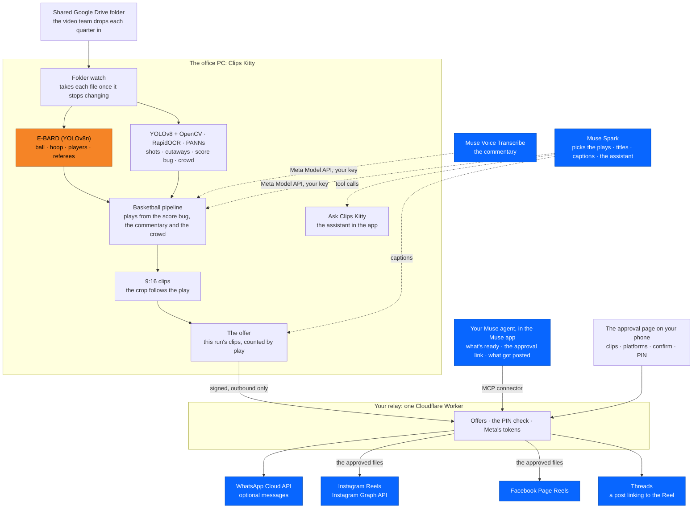

# Architecture

Meta's pieces in blue, E-BARD in orange. The same diagram is in the
[README](../../../README.md#architecture).



In detail: three pieces. The creator's Windows PC runs Clips Kitty with
the pipeline unchanged. A small relay the creator deploys once (Cloudflare
Worker + D1) talks to Meta's official APIs. The PC never accepts a
connection from the internet; it only calls out to the relay, and to
Meta's Model API for Muse Spark and Muse Voice on the creator's own key.

```
 Creator's Windows PC (127.0.0.1 only)                Relay (Cloudflare Worker, D1)              Meta
 ─────────────────────────────────────                ─────────────────────────────              ────
 Basketball pipeline (E-BARD, YOLO, OpenCV,           holds: WhatsApp token, Meta + Threads
   scoreboard, events, crop, render)  [unchanged]       app secrets, page/IG/Threads tokens
        │ job finishes                                   (sealed with TOKEN_KEY)
        ▼
 server/jobs.py _announce ──► remote_approval/notifier
        │  offer: clip snapshot (size+mtime pinned),
        │  fingerprint, counts from the pipeline's events
        ▼
 remote_outbox (SQLite) ── publish worker tick ──► POST /v1/notify (HMAC-signed) ──► WhatsApp Cloud API
                                                    makes approval apr_…, link token         │ template
                                                    (hash stored), thumbnails                ▼
                                                                                        creator's phone
                                                    GET/POST /a/<token>  ◄──────────── opens "Review clips"
                                                    page: clips, platforms, confirm,
                                                    PIN (PBKDF2, lockout), CSRF, Origin
                                                    → signed command (approve/defer/cancel)
 publish worker tick ── GET /v1/commands ─────────►
   commands.handle: signature, offer, fingerprint,
   expiry, age, clips ⊆ offer, platforms connected,
   files unchanged → APPROVED → publish_jobs (provider "meta")
   ── POST /v1/commands/<id>/ack ──────────────────► command accepted (now its steps are allowed)

 publish worker _publish → remote_approval/publishing → publish/meta_graph
   POST /v1/meta/<op>  (each Graph step, named   ──► checks the step against the accepted ──► Graph API v26:
   by command + clip + platform)                      command, clip, platform, 24h window       IG Reels (resumable),
   POST /v1/meta/upload (the rendered file,      ──► streams bytes to rupload with the     ──► FB Page Reels,
   streamed; no re-render)                            account token                            Threads
                                                 ◄── ids and permalinks the API returned
   clip_publishes rows (provider "meta")
   settle → PUBLISHED / PARTIAL_FAILURE / FAILED
   outbox "result" ── POST /v1/notify ───────────► ck_publish_update template ─────────────► phone
```

## Watches and the Muse agent

```
 Watch page (server/automation.py)                     Relay                                    Muse (Meta's servers)
   YouTube RSS, Twitch VODs, Kick, or a folder           POST /mcp, /muse/v1/* ◄── Muse key ───── the creator's Muse agent:
   (sources/folder_feed.py): a new video is queued         (lib/muse.js)                           "what's ready?",
   as a job with the watch's options                       reads this PC's offers and results,    "send me the link",
        │ job finishes                                     hands over the /a/<token> link,        "what got posted?"
        ▼                                                  reminds or cancels as a signed
 notifier.watch_choice: "phone" → offered,                 command marked via "muse"
   whatever kind the video is
        │
 outbox ── POST /v1/notify ───────────────────────────►  offer kept for Muse (no WhatsApp needed),
                                                         or sent on WhatsApp as before
 watcher: the video's row says "Ready to approve from your phone." once the offer exists
```

Muse can't reach the PC (it runs on Meta's servers), so it reads what the PC
already sends the relay. Approving still takes the `/a/<token>` page and the
PIN; the PC refuses any approval marked as coming from Muse.

## On the PC

| Module | Role |
|---|---|
| `remote_approval/notifier.py` | Called once from the job announcer. Basketball jobs, every other video once **Offer gaming and other videos too** is ticked, and whatever a watch set to **Ask me on my phone** queued. Offers only the clips this run made; makes the offer, never sends anything itself. |
| `remote_approval/summary.py` | The offer's kind (basketball, gaming or video) and its counts in that kind's words: basketball plays from the clips' own `sport_event` (clutch, dunks, threes, blocks, steals, big moments and so on), a game pipeline's own labels, or highlights. Also the snapshot of each offered file (path, size, mtime) and the offer's fingerprint. |
| `remote_approval/states.py`, `store.py` | The state machine (allowed moves only, `BEGIN IMMEDIATE`), the outbox (one row per event key: the duplicate guard), commands seen (replay guard), audit log. |
| `remote_approval/service.py` | The loop on the publish worker's thread: expire, settle, send the outbox, collect decisions. Paces itself: seconds while something is open, two minutes otherwise, nothing while off. Plus the actions Settings takes. |
| `remote_approval/commands.py` | Checks each decision from the phone against the offer on this PC. Only this file turns an approval into publish jobs. |
| `remote_approval/relay.py` | The signed HTTP client. Every request carries the device id, a timestamp, a nonce and an HMAC-SHA256 over method, path, timestamp, nonce and body hash. |
| `remote_approval/publishing.py` | One approved clip to the chosen platforms, Instagram and Facebook first so Threads can link to a confirmed Reel. Called by the existing publish worker. |
| `publish/meta_graph.py` | Meta's steps in Meta's order, through the relay; error codes turned into messages a creator can act on. |
| `remote_approval/captions.py` | Muse Spark: one strict-JSON request per offer, cached by fingerprint and model. |
| `remote_approval/usage.py` | Token, audio-second and message counts with estimated cost. |
| `server/remote_approval_api.py` | Settings routes, including making and revoking the Muse key; every change needs the desktop session header. |
| `server/automation.py` | The existing watcher. A watch set to **Ask me on my phone** never publishes from the PC; its video's row says whether the clips reached the phone, read from the offer itself. |
| `sources/folder_feed.py`, `sources/local_file.py` | Watched folders: video files that have stopped changing and that nothing is still writing, given the same id and copy step as a file added by hand. |
| `server/agent.py` (`muse_backend`) | **Ask Clips Kitty** on Muse Spark whenever a Meta key is saved, with the app's own tools, whatever model picks the clips. |

Integration points with existing code, kept deliberately small: one call in
`server/jobs.py`, one step and one branch in `server/publisher.py`, four new
tables in `core/state.py`, one `install()` in `server/api.py`. The later
additions touch the watcher (`server/automation.py`), the assistant
(`server/agent.py` and its two routes) and the local-file route, whose id
and copy step moved to `sources/local_file.py` unchanged.

## On the relay

`meta-relay/worker.js` (routes), `lib/whatsapp.js` (Cloud API sends,
templates, error meanings), `lib/meta.js` (Facebook Login, Threads Login,
the Graph steps, uploads), `lib/page.js` (the approval page: server-rendered
HTML, no JavaScript, strict CSP), `lib/crypto.js` (HMAC, AES-GCM sealing,
PBKDF2 PIN hashing), `lib/muse.js` (the Muse connector), `lib/db.js`
(shared database helpers), `schema.sql` (D1). A cron every 10 minutes expires
offers, sends reminders and refreshes Threads tokens.

The Muse connector: `POST /mcp` (MCP, plain JSON, no sessions), the same
tools at `/muse/v1/...`, their OpenAPI description at `/muse/openapi.json`
and a setup guide at `/muse`. Keys are made by the PC through the signed
`/v1/muse/token` and `/v1/muse/revoke`, and kept in `connector_tokens` as
SHA-256 only, each allowed 60 calls a minute. A Muse key works only on
the connector's routes, and the PC's signature never does. Wrong PINs:
five lock the page for 15 minutes, each try counted before it is checked;
three of those lockouts within a day (`pin_lockouts`) block approving from
the phone until a new PIN is set on the PC.

## Why a relay at all

WhatsApp webhooks and OAuth redirects need a public HTTPS address, and the
Meta app secret must live on a server. The brief also says the PC's FastAPI
service must not be exposed and the public desktop client must not hold app
secrets or long-lived tokens. A relay the creator owns satisfies all of
that with the least: no always-on processing (the video work stays on the
PC), one Worker and one small database, inside Cloudflare's free tier for a
single creator.

## Muse models

- **Muse Spark** (`muse-spark-1.3`) writes text: titles, Instagram captions,
  Facebook descriptions, Threads posts, hashtags, and an optional one-line
  summary, in one structured request per offer. It does not send anything.
- **Muse Spark** also runs **Ask Clips Kitty**, the box at the bottom of the
  app, whenever a Meta key is saved: it calls the app's own tools (queue a
  video, list clips and so on) through the local engine, and its tool
  requests ask for brief reasoning (`reasoning_effort: "low"`).
- **Muse Voice Transcribe** (`muse-voice-transcribe-1.0`) is an option in
  Settings → AI → Transcription, on the existing interface, with local
  Whisper as the fallback.
- **WhatsApp** delivers, or, with WhatsApp off, the relay keeps the offer for
  the creator's **Muse agent** to read through the connector. The ready
  message is deterministic (from the job's real metadata); the Muse Spark
  summary line, when the creator turns it on, goes on the approval page,
  never in the message.
