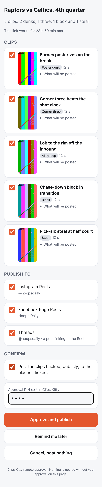

# Remote approval

How a finished video becomes posts the creator approved from their phone,
and every rule along the way.

## The flow

1. **The job finishes.** The job announcer calls the notifier. For a
   basketball `process` job with WhatsApp on (or any video, once Settings
   has **Offer gaming and other videos too** ticked), it snapshots the best
   of the clips this run made (up to `max_clips`, best score first, skipping
   missing files, Longform cuts, story reels and clips already posted
   everywhere), pins each file's size and modification time, computes a
   fingerprint over them, and counts highlights by category from the
   pipeline's own events. State:
   `READY_FOR_REVIEW` → `NOTIFICATION_PENDING`. A failed job queues the plain
   failure message instead, with no error text.
2. **The message goes out.** The publish worker's loop sends the outbox to
   the relay. The relay creates an approval (`apr_…`), a 32-byte link token
   (only its hash is stored), keeps the thumbnails, and sends the
   `ck_highlights_ready` template: *"Clips Kitty finished your video
   {{title}}. Ready to review: {{5 clips: 2 dunks, 1 three, 1 block and 1
   steal}}. Choose where to publish them before the link expires."* with
   **Review clips**, **Remind me later** and
   **Cancel**. State: `NOTIFICATION_SENT`, then `AWAITING_APPROVAL` once
   WhatsApp reports it delivered or the link is opened.
3. **The phone decides.** The page lists the offered clips (thumbnail, play,
   length, and what will be posted), only the platforms that are connected
   (preferred ones pre-ticked), a confirm box, and the PIN. Approve sends a
   signed `approve` command naming exactly the clips and platforms ticked.
   Remind me later → `DEFERRED` and a reminder after `remind_minutes`.
   Cancel → `CANCELLED`, nothing posted.
4. **The PC checks it.** On its next pass the PC collects commands and
   checks each one itself (below). An accepted approval becomes one publish
   job per clip on the existing publish queue. State: `APPROVED` →
   `PUBLISH_QUEUED`. The PC acknowledges the command; only then does the
   relay allow its Graph steps.
5. **It publishes.** The publish worker runs each job: Instagram Reels, then
   Facebook Page Reels, then Threads (a post linking to the Reel just
   confirmed). The file uploaded is the one the pipeline rendered, checked
   again for size and modification time first. State: `PUBLISHING`.
6. **Results.** When every job has finished, the offer settles from what the
   APIs confirmed: `PUBLISHED` (all), `PARTIAL_FAILURE` (some), `FAILED`
   (none). The `ck_publish_update` template says *"3 of 4 posts published (1
   failed)"* and links to the status page, which lists each confirmed link
   exactly as the API returned it.

## What the PC checks before anything is queued

`remote_approval/commands.py`, for every command:

- The relay's signature over the command (canonical JSON, HMAC with this
  PC's device secret). A bad signature is rejected and not recorded.
- Not seen before (command id), so a command delivered twice applies once.
- It names an offer this PC made: both the relay's approval id and this
  PC's own offer id must match the same offer.
- Remote approval is switched on in Settings.
- The offer is still open (not expired, cancelled, or already approved).
- The fingerprint matches: the offer the phone saw is the offer on this PC.
  An old approval can never apply to new clips.
- It was decided before the link expired, and is no more than 48 hours old
  when the PC sees it. Otherwise the offer becomes `EXPIRED` and the creator
  is asked again rather than having it posted late.
- At least one clip, every clip in the offer.
- At least one platform, every platform known and connected.
- Every chosen file is unchanged since the offer.

## Duplicate and replay protection

- Outbox rows are keyed by event (`ready:job:7:1`, `result:review:3:1`);
  the relay keys messages on the same key, so a retry after a lost answer is
  not a second WhatsApp message.
- Commands are recorded by id on the PC; a second delivery returns the first
  outcome. A second approval of the same offer is ignored.
- Each signed request carries a timestamp (±5 minutes) and a nonce the relay
  remembers for 15 minutes.
- WhatsApp webhook events are de-duplicated by message id and status.
- On the relay, each Graph step is bound to the accepted command, the clip
  and the platform, at most three container creations per clip and
  platform, and only within 24 hours of the approval.
- On the PC, a platform already published for a clip is never posted again
  by a retry, and an upload cut off by a restart is reported as
  "unconfirmed: check the account" and never retried automatically (the
  existing publish worker's rule).
- A platform a clip is already posted on, or on its way to (a post
  WoopSocial has scheduled, an upload in progress), by any publisher, is
  left out of an approval and shown as skipped in the results. The approval
  page says where a clip is already posted.

## When the PC is off

The approval waits on the relay; the page says *"Approved. Waiting for your
PC to pick this up. If it is off, it will start when it is back on, as long
as that is within 48 hours."* The PC picks it up on its first pass after it
starts. Nothing is claimed as uploaded until the API confirms it.

## From the app

Settings → Notifications & Remote Approval lists recent offers with their
state and confirmed links, and can **Cancel** (before an upload starts),
**Retry failed** (only the failed platforms, under the same approval),
**Ask again** (a new offer with a new link for an expired or cancelled one),
and **Send again** (after WhatsApp could not deliver, with a fresh link).

## Messages and quick replies

| Event | Template | Notes |
|---|---|---|
| Highlights ready | `ck_highlights_ready` | Title and counts from the job; optional Muse Spark line only when turned on |
| Processing failed | `ck_processing_failed` | Exactly: "Clips Kitty could not finish processing your video. Open the app for details." No error text, no path |
| Publishing finished | `ck_publish_update` | Counted from confirmed results only; links are on the status page |
| Test | `ck_test_message` | From Settings |

Replies the relay understands: **Remind me later**, **Cancel** (buttons,
bound to the message they came from), `STOP`, `START`, and `LINK <code>` for
pairing. A plain "yes", "ok" or "publish" never approves anything: it gets a
reply pointing to the link, because it can't say which clips, where, or for
which video.
